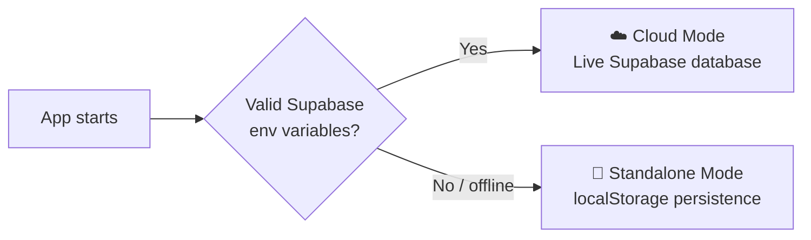

<div align="center">

# 🧵 Urban Thread

### Contemporary Fashion Studio & E-Commerce

**A luxury, editorial-grade clothing store built with React 18, Vite and Supabase.**


[Live Demo](https://your-app.vercel.app) · [Report a Bug](../../issues) · [Request a Feature](../../issues)

<!-- Add a hero screenshot or GIF of the storefront here -->


</div>

---

## 📑 Table of Contents

- [About](#-about)
- [Features](#-features)
- [Tech Stack](#-tech-stack)
- [Quick Start](#-quick-start)
- [Demo Access](#-demo-access)
- [Supabase Configuration](#-supabase-configuration-optional)
- [Routes](#-routes)
- [Production Build & Deployment](#-production-build--deployment)
- [Screenshots](#-screenshots)
- [License](#-license)

---

## 📖 About

**Urban Thread** is a complete online clothing store with a polished, magazine-style design. Shoppers can browse and filter the catalogue, build a bag, check out, and manage their account. Store owners get a studio admin workspace to track revenue, manage garments and update orders.

The app works with or without a backend. Connect Supabase for live data, or run it standalone with no setup at all.

---

## ✨ Features

### 🛍️ For Shoppers

- **Editorial Luxury Aesthetics**: curated high-resolution fashion photography, *Playfair Display* and *Plus Jakarta Sans* typography, obsidian and champagne-gold accents, and fluid responsive layouts
- **Comprehensive Catalogue & Filters**: filter by gender (Women / Men), category, size, color and max price, sort by Newest, Price or Rating, and find pieces with instant autocomplete search
- **Product Details Page**: multi-angle high-resolution gallery, interactive color swatches, size selector with sold-out flags, quantity stepper, expandable garment care accordions and related-pieces recommendations
- **Slide-Out Bag (Cart Drawer)**: live quantity adjustments, a free express shipping meter (unlocked at **$75**) and promo code validation (try `URBAN15` for 15% off)
- **Native Authentication**: dedicated `/login` and `/signup` pages with email validation, a show/hide password toggle and **1-click demo login** buttons
- **Member Account Portal**: order history with status pills, a saved wardrobe wishlist and an editable delivery profile for faster checkout

### 🏢 For Store Owners

- **Studio Admin Workspace**:
  - KPI dashboard with Revenue, Orders, Garment count and Average Order Value (AOV)
  - Inline price editing
  - Garment creation and edit form
  - Order status management: *Pending → Contacted → Paid → Delivered*
  - Direct WhatsApp messaging to customers

---

## 🛠 Tech Stack

| Layer | Technology |
|-------|------------|
| **Frontend** | React 18, Vite |
| **Backend / Database** | Supabase (optional) |
| **Offline Fallback** | Browser `localStorage` |
| **Typography** | Playfair Display, Plus Jakarta Sans |
| **Deployment** | Vercel (`vercel.json` included) |

---

## ⚡ Quick Start

**Prerequisites:** [Node.js](https://nodejs.org/) v18 or higher and npm.

```bash
cd shop
npm install
npm run dev
```

The app will be available at **http://localhost:5173**.

No database is needed to try it. Urban Thread starts in standalone mode by default.

---

## 🔑 Demo Access

Test every customer and admin feature immediately, with no configuration.

### Fast 1-Click Access

On the `/login` or `/admin` page, click:

| Button | What it does |
|--------|--------------|
| **⚡ Demo Customer** | Signs you in as a customer with sample orders and a saved shipping profile |
| **⚡ Demo Admin** | Opens the studio control panel instantly |

### Manual Credentials

| Role | Email | Password | Access Route |
|------|-------|----------|--------------|
| **Store Admin** | `admin@urbanthread.com` | `admin2026` | `/admin` |
| **VIP Customer** | `customer@urbanthread.com` | `demo1234` | `/login` → `/account` |

> 💡 **Tip:** you can also reach the admin page at any time by tapping the **Urban Thread** logo 5 times in quick succession.

> ⚠️ These are demo-only credentials for local testing. Change or remove them before using the app with real customers.

---

## 🌿 Supabase Configuration (Optional)

Urban Thread auto-detects which mode to run in:



| Mode | When it activates | Data storage |
|------|-------------------|--------------|
| **☁️ Cloud Mode** | Valid `VITE_SUPABASE_URL` and `VITE_SUPABASE_ANON_KEY` are provided | Live Supabase database |
| **💾 Standalone Mode** | Supabase is not configured or is offline | Browser `localStorage` |

### Environment Variables

Create a `.env` file in the project root:

```env
VITE_SUPABASE_URL=https://<your-project-ref>.supabase.co
VITE_SUPABASE_ANON_KEY=<your-anon-jwt-key>
VITE_ADMIN_PATH=/admin
VITE_SELLER_WHATSAPP=2340000000000
```

| Variable | Description |
|----------|-------------|
| `VITE_SUPABASE_URL` | Your Supabase project URL. Do **not** append `/rest/v1`; the client adds the correct path |
| `VITE_SUPABASE_ANON_KEY` | Your Supabase anon (public) key |
| `VITE_ADMIN_PATH` | Route for the admin workspace (default `/admin`) |
| `VITE_SELLER_WHATSAPP` | Seller's WhatsApp number in international format, used for customer messaging |

> 🔒 Never commit your `.env` file, and never use the Supabase `service_role` key in frontend code. Protect your data with Supabase Row Level Security (RLS) policies.

---

## 🧭 Routes

All routes are pre-configured for client-side routing.

| Route | Page |
|-------|------|
| `/` | Home |
| `/shop` | Catalogue with filters and search |
| `/product/:id` | Product details |
| `/cart` | Shopping bag |
| `/checkout` | Checkout |
| `/login` | Sign in |
| `/signup` | Create account |
| `/account` | Member account, orders and wishlist |
| `/admin` | Studio admin workspace |

---

## 🚀 Production Build & Deployment

Bundle the app for production and preview it locally:

```bash
npm run build
npm run preview
```

### Deploy to Vercel

The included `vercel.json` handles client-side routing, so every route works on refresh.

1. Import the repository into [Vercel](https://vercel.com).
2. Add your environment variables under **Settings → Environment Variables**.
3. Deploy.

---

## 🖼 Screenshots

| Storefront | Product Page |
|------------|--------------|
|  |  |

| Cart Drawer | Admin Dashboard |
|-------------|-----------------|
|  |  |

---

## 📜 License

Add your license here (for example, MIT). See [`LICENSE`](LICENSE) for details.

---

<div align="center">

Crafted with care · ⭐ Star this repo if you like it!

</div>
